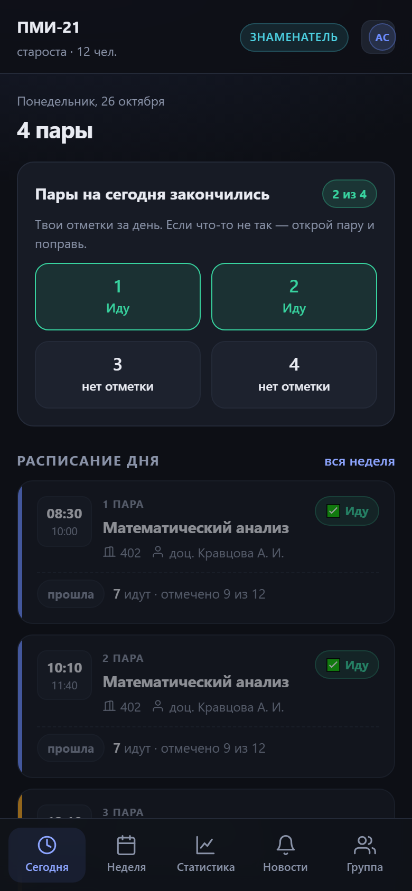
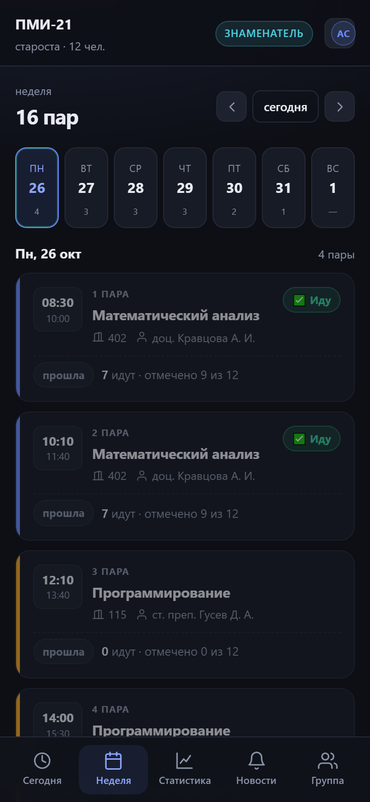
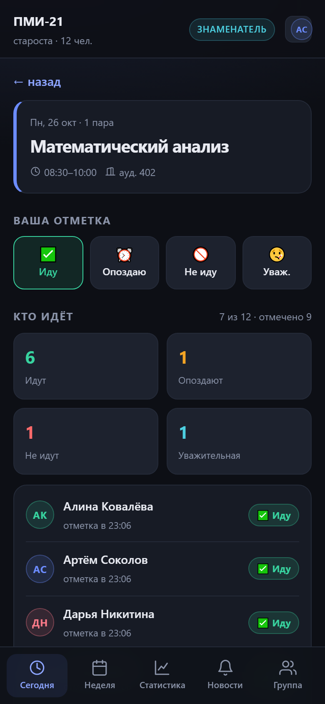
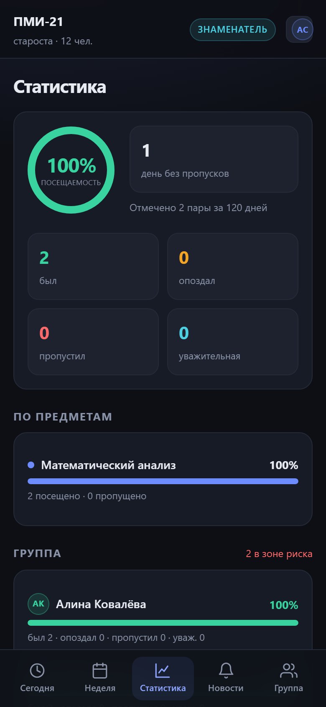
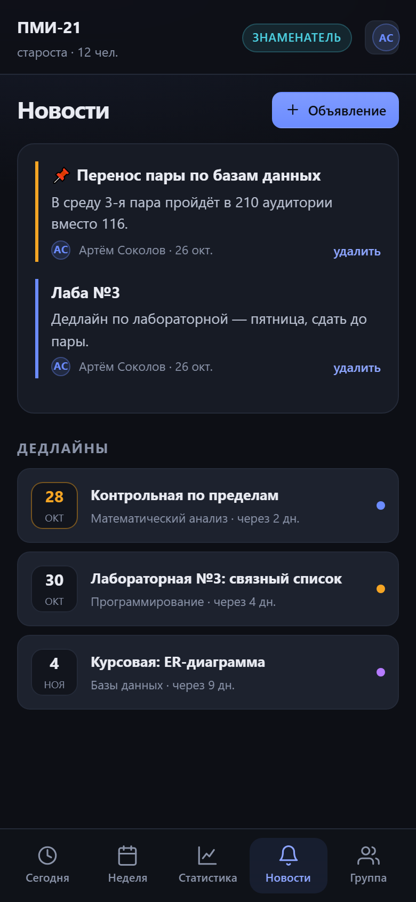
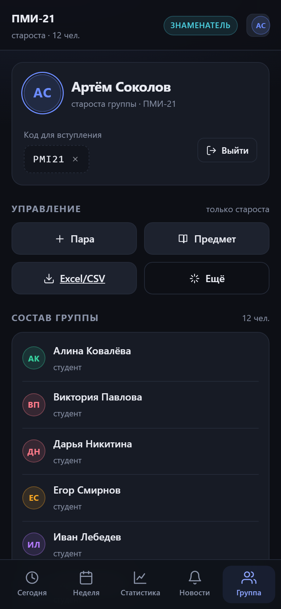
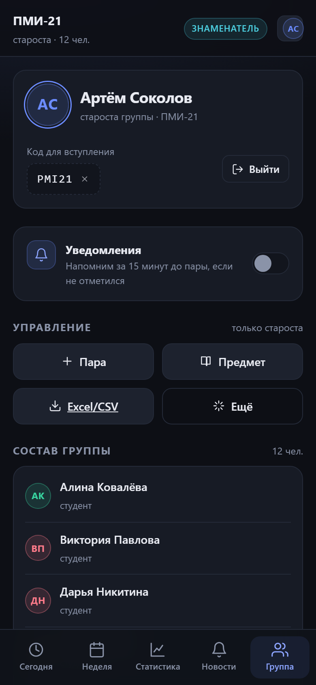
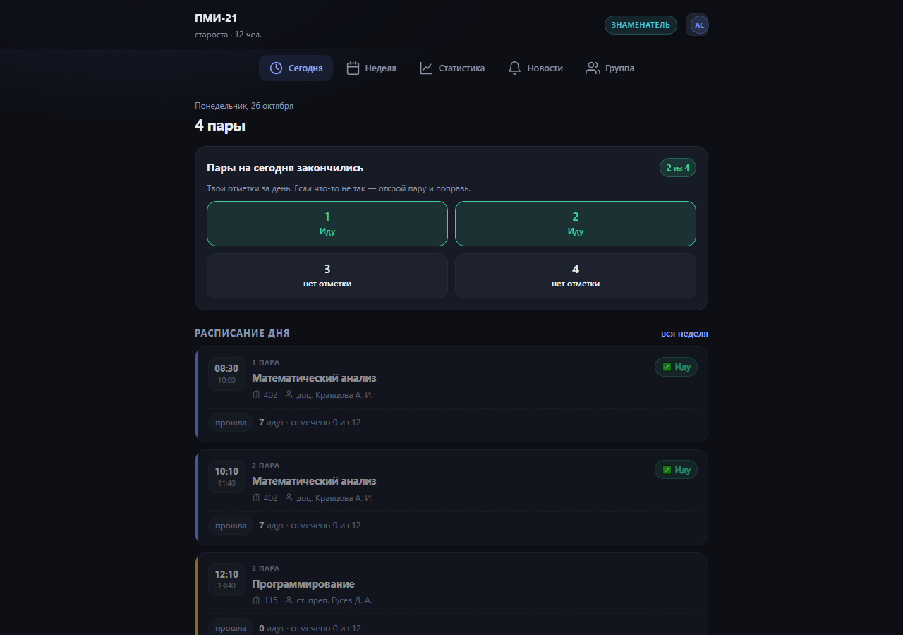

# Группа

Приложение для старосты и студентов: расписание пар, отметка посещаемости в один тап,
live-список «кто идёт» и статистика. Тёмная тема, mobile-first, ставится на телефон как PWA.

**Стек:** Node.js 22+ · Express 5 · `node:sqlite` (встроенный, без native-сборки) · React 19 · Vite.
Никаких ORM, ORM-миграций и нативных модулей — разворачивается где угодно, где есть Node.

## Возможности

- **Расписание** — неделя с чётностью (числитель/знаменатель), пары с аудиторией и преподавателем
- **Отметка посещаемости** — «Иду / Опоздаю / Не иду / Уважительная», одна кнопка
- **«Кто идёт»** — живой список группы на паре, обновляется через SSE без перезагрузки
- **Статистика** — процент посещаемости, разбивка по предметам, серия дней без пропусков
- **Староста** — видит всю группу, должников, добавляет пары и предметы, экспортирует CSV
- **Новости и дедлайны** — объявления от старосты, даты сдачи
- **Уведомления** — Web Push: напоминание за 15 минут до пары, если не отметился; push об объявлениях
- **PWA** — устанавливается на телефон, иконки, автономный режим оболочки

## Запуск

```bash
pnpm install
pnpm build          # собирает фронтенд в public/
pnpm start           # http://127.0.0.1:47824
```

Для разработки с горячей перезагрузкой — два терминала:

```bash
node --watch server/index.js   # API на :47824
pnpm exec vite                 # UI на :5173 с прокси на API
```

Переменные окружения: `PORT` (по умолчанию 47824), `HOST` (0.0.0.0), `DATA_DIR` (`./data`),
`SEED_DEMO=0` — не засеивать демо-данные.

## Демо

При первом запуске на пустой базе создаётся группа **ПМИ-21** (12 человек, 6 предметов,
расписание на неделю). Вход:

| Роль | Имя | Пароль |
|---|---|---|
| староста | `Артём Соколов` | `demo1234` |

Код группы: **PMI21**. Остальные студенты входят по тому же коду, пароль `demo1234`.

## Как это выглядит

| Сегодня | Неделя |
|---|---|
|  |  |

| Кто идёт | Статистика |
|---|---|
|  |  |

| Новости | Группа |
|---|---|
|  |  |

| Уведомления | Отметка |
|---|---|
|  |  |



## API

| Метод | Путь | Описание |
|---|---|---|
| GET | `/api/health` | статус |
| POST | `/api/auth/login` | вход по коду группы + имя + пароль |
| POST | `/api/auth/register` | регистрация студента |
| GET | `/api/me` | профиль, группа, счётчики |
| GET | `/api/today` | пары на сегодня + текущая/следующая |
| GET | `/api/schedule?week=YYYY-MM-DD` | неделя |
| POST | `/api/attendance` | отметка `{slotId, date, status}` |
| GET | `/api/attendance/:slotId?date=` | кто идёт |
| GET | `/api/stats/me` · `/api/stats/group` | статистика |
| GET | `/api/announcements` · `/api/deadlines` | новости |
| GET | `/api/export/attendance.csv` | экспорт (староста) |
| GET | `/api/push/key` | публичный VAPID-ключ |
| POST | `/api/push/subscribe` | подписка на уведомления |
| POST | `/api/push/test` | тестовое уведомление |
| GET | `/api/events` | SSE-поток live-обновлений |

## Проверка

```bash
node scripts/smoke.mjs          # 40 проверок API: роли, отметки, экспорт, безопасность
node scripts/screenshots.mjs    # скриншоты всех экранов + ошибки консоли в shots/
node scripts/make-icons.py      # перегенерировать PWA-иконки
```

## Деплой

### Показать группе прямо сейчас — 0 ₽

**Публичная HTTPS-ссылка** через serveo (без аккаунта):

```powershell
powershell -ExecutionPolicy Bypass -File scripts/tunnel-serveo.ps1
```

Ссылка вида `https://....serveousercontent.com` живёт, пока открыто окно и компьютер включён.
Важно: цель — `127.0.0.1`, не `localhost` (на Windows `localhost` → IPv6 `::1`, сервер слушает IPv4, будет 502).
Бесплатный serveo показывает посетителям страницу-предупреждение.

Cloudflare-туннели (`scripts/tunnel.ps1`) удобнее и без предупреждения, но на некоторых сетях
не регистрируются (`Register tunnel error: context deadline exceeded`).

**Локальная сеть** — если телефон в той же Wi-Fi:

```
http://<IP-компьютера>:47824
```

Windows спросит про доступ к сети — надо разрешить (или добавить правило для порта 47824).
Учтите: по `http://` браузеры не дают включить push-уведомления — нужен HTTPS.

### Постоянный хостинг

| Вариант | Цена | Диск | Нюанс |
|---|---|---|---|
| Oracle Cloud Always Free | 0 ₽ | есть | нужна карта для верификации, ARM-виртуалка |
| Render free | 0 ₽ | **нет** | засыпает через ~15 мин, база теряется при рестарте |
| Render + Neon Postgres | 0 ₽ | внешняя БД | нужна миграция слой `server/db.js` на Postgres |
| VPS (Timeweb, Aeza, Hetzner) | 150–300 ₽/мес | есть | самый простой и предсказуемый путь |

**Docker** (работает на любом VPS):

```bash
docker build -t gruppa .
docker run -d -p 8080:8080 -v gruppa-data:/data --name gruppa gruppa
```

**Render** — в репозитории есть `render.yaml`, но на free-плане без диска данные не переживут
рестарт. Для настоящей группы выбирайте вариант с диском.


## Структура

```
server/
  index.js     express, статика, SPA-фолбэк
  api.js       все маршруты + SSE-хаб
  db.js        схема, миграции, демо-данные
  auth.js      scrypt-пароли, сессии, middleware
  time.js      ISO-недели, чётность, пары
web/
  src/         React-приложение
  public/      манифест, иконки
scripts/       smoke-тест, скриншоты, генератор иконок
```
